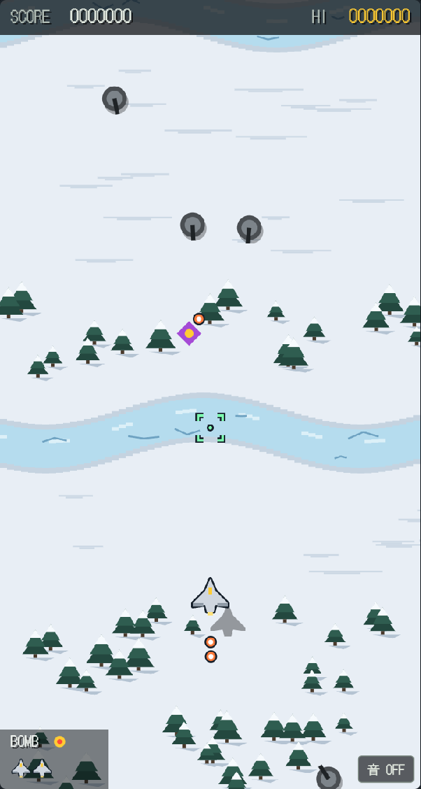

# テラボマー（TERRA BOMBER）

スマホのブラウザですぐ遊べる、縦スクロールの対地攻撃シューティングです。
インストールは不要で、PCでも遊べます。

**[今すぐ遊ぶ](https://tigerdriver.github.io/terra-bomber/)**

## 遊び方

照準を地上の敵に重ねて爆撃しながら、空の敵と弾をよけて進みます。
照準が敵に重なって赤くなると、爆弾は自動で落ちます。
空の敵は通常の爆弾では倒せないので、基本はよけて進みます。

| 操作 | スマホ | PC |
| --- | --- | --- |
| 移動 | 指でなぞる | 矢印キー / ドラッグ |
| 爆弾を落とす | タップ | スペースキー |
| 全滅ボム | ダブルタップ | Bキー |

### 全滅ボム

追い詰められたときの切り札です。スタート時に1発持っています。

- 画面内の地上の敵を、耐久力の高い要塞も含めてすべて破壊します。
- 空の敵も一掃できます。通常の爆弾では倒せない空の敵を倒せるのは、全滅ボムだけです。
- 敵の弾をすべて消し、使った直後の約1秒間は無敵になります。
- 倒した敵のぶんのスコアも入ります。

### 1UPとボムの追加

スコアが20,000点に達すると、残機と全滅ボムが1つずつ増えます。
その後は50,000点、80,000点と、30,000点ごとに増えていきます。
全滅ボムは3発まで持てます。

## 特徴

- **3つのエリア**：雪原、緑地、荒野の順に地形が変わり、進むほど敵が手強くなります。
- **攻めるほど忙しくなる**：前に出れば地上の敵を早く叩けますが、空の敵は速く、多くなります。
- **画面に合わせた表示**：縦長のスマホでは、そのぶん先の地形まで見渡せます。
- **ハイスコアの記録**：ハイスコアはブラウザに保存されます。

## 技術

HTML、CSS、JavaScriptだけで作っており、ライブラリもビルドも使っていません。
グラフィックはCanvas 2Dで描き、効果音はWeb Audio APIで鳴らしています。
画像や音声のファイルはなく、Webフォント（DotGothic16）を除くすべてが `index.html` 1ファイルに収まっています。

ローカルで動かすときは、`index.html` をブラウザで開いてください。

## 制作について

Claudeと対話しながら作りました。
